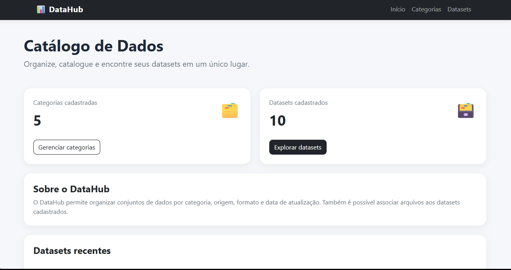
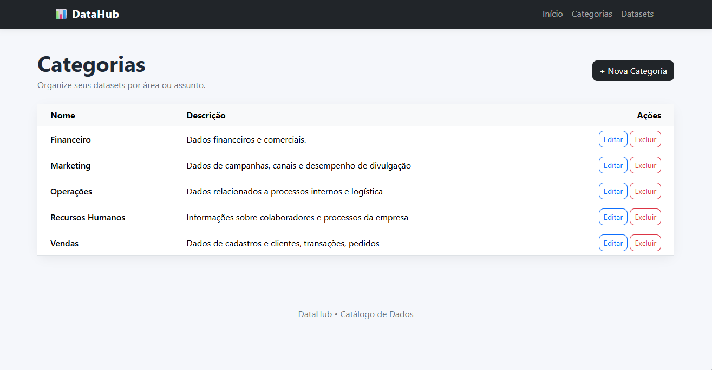
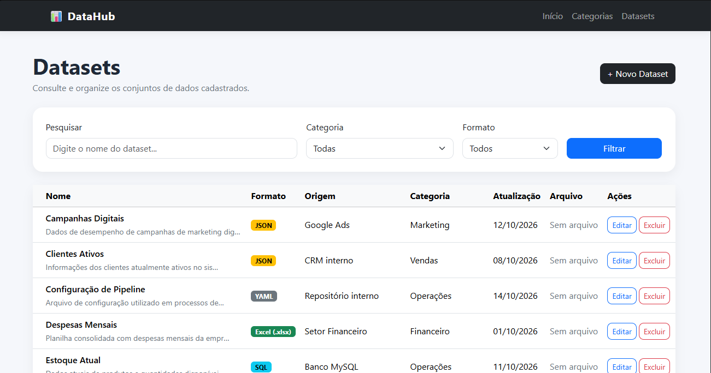
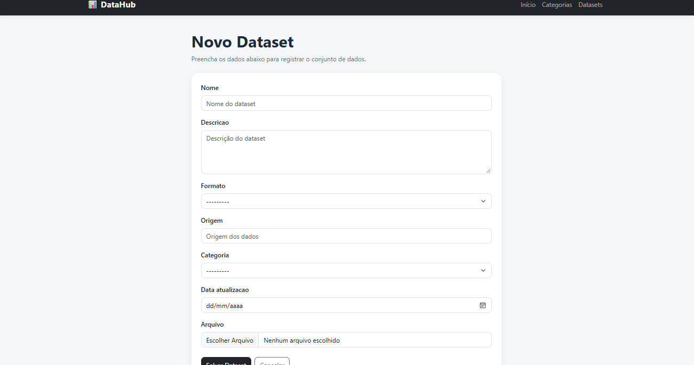

# DataHub 📊

O **DataHub** é uma aplicação web desenvolvida para cadastrar, organizar e encontrar datasets de forma simples.

A versão atual, **vAlpha**, permite organizar datasets por categoria, pesquisar e filtrar registros, anexar arquivos e validar se a extensão enviada corresponde ao formato selecionado. O projeto também possui autenticação de usuários e controle de acesso às páginas do catálogo.

O objetivo é desenvolver, gradualmente, uma aplicação que facilite a organização e o gerenciamento de conjuntos de dados.

---

## Screenshots

### Dashboard



### Categorias



### Datasets



### Novo Dataset



---

## O que é um dataset?

Um **dataset** é, de forma simples, um conjunto de dados relacionados.

Pode ser, por exemplo:

- Uma planilha com vendas;
- Um CSV com clientes;
- Um JSON recebido de uma API;
- Dados de funcionários;
- Registros de estoque;
- Resultados de uma pesquisa.

Um arquivo `vendas_2026.csv`, por exemplo, poderia ter:

| id | produto | quantidade | valor | data |
|---:|---|---:|---:|---|
| 1 | Notebook | 2 | 3500.00 | 10/01/2026 |
| 2 | Teclado | 5 | 150.00 | 10/01/2026 |
| 3 | Monitor | 1 | 1200.00 | 11/01/2026 |

Nesse caso, cada linha representa um registro e cada coluna representa uma informação sobre aquele registro.

O DataHub não guarda apenas o arquivo. Ele também registra informações sobre ele, como nome, origem, formato, categoria e data de atualização.

Essas informações são chamadas de **metadados**.

Por exemplo:

```text
Arquivo: vendas_2026.csv
Nome: Vendas 2026
Formato: CSV
Origem: Sistema ERP
Categoria: Vendas
Atualização: 10/10/2026
```

A ideia do projeto é facilitar esse tipo de organização: saber **quais dados existem, de onde vieram, em qual formato estão e onde encontrá-los**.

---

## Funcionalidades

Atualmente, o DataHub possui:

- CRUD completo de categorias;
- CRUD completo de datasets;
- Relacionamento entre Categoria e Dataset com `ForeignKey`;
- Upload de arquivos;
- Validação da extensão do arquivo;
- Pesquisa por nome;
- Filtro por categoria;
- Filtro por formato;
- Dashboard com quantidade de categorias e datasets;
- Listagem dos datasets cadastrados recentemente;
- Cadastro e autenticação de usuários;
- Confirmação de cadastro por e-mail;
- Logout;
- Proteção das páginas do catálogo para usuários não autenticados;
- Mensagens de feedback para as operações;
- Interface responsiva com Bootstrap.

---

## Categorias

As categorias servem para agrupar datasets por assunto ou área.

Alguns exemplos:

```text
Financeiro
Vendas
Marketing
Recursos Humanos
Operações
```

Uma categoria pode possuir vários datasets:

```text
Vendas
├── Vendas 2026
├── Clientes Ativos
└── Pedidos Cancelados
```

---

## Datasets

Cada dataset cadastrado pode possuir:

```text
Nome
Descrição
Formato
Origem
Categoria
Data de atualização
Arquivo
```

Exemplo:

```text
Nome: Indicadores Financeiros
Formato: Parquet
Origem: Data Warehouse
Categoria: Financeiro
Data de atualização: 13/10/2026
```

---

## Formatos aceitos

| Formato | Extensão | Uso comum |
|---|---|---|
| CSV | `.csv` | Dados em linhas e colunas. |
| JSON | `.json` | Dados estruturados, muito usado em APIs e aplicações web. |
| Excel | `.xlsx` | Planilhas do Excel. |
| Excel legado | `.xls` | Formato mais antigo de planilhas do Excel. |
| SQL | `.sql` | Scripts SQL ou exportações de banco de dados. |
| TXT | `.txt` | Arquivos de texto simples. |
| XML | `.xml` | Dados estruturados em tags. |
| Parquet | `.parquet` | Formato colunar eficiente, muito usado em Engenharia de Dados. |
| Avro | `.avro` | Serialização e troca de dados em sistemas distribuídos. |
| TSV | `.tsv` | Parecido com CSV, mas usa tabulações. |
| YAML | `.yaml` / `.yml` | Muito usado em arquivos de configuração. |
| Outro | — | Para arquivos fora das opções anteriores. |

### XML

O **XML (eXtensible Markup Language)** é um formato de texto usado para armazenar e trocar dados estruturados por meio de tags.

Exemplo:

```xml
<dataset>
    <nome>Vendas 2026</nome>
    <origem>Sistema ERP</origem>
    <categoria>Vendas</categoria>
</dataset>
```

### Parquet

O **Parquet** utiliza armazenamento colunar e é muito usado para processamento de grandes volumes de dados.

Exemplo de representação dos dados:

```text
nome       idade    cidade
Ana        22       São Paulo
Carlos     28       Rio de Janeiro
Mariana    25       Fortaleza
```

O Parquet é um formato binário que organiza os dados internamente por colunas, facilitando consultas e análises eficientes.

### Avro

O **Avro** é um formato de serialização bastante utilizado em sistemas distribuídos.

Exemplo de esquema Avro em JSON:

```json
{
    "type": "record",
    "name": "Pessoa",
    "fields": [
        {"name": "nome", "type": "string"},
        {"name": "idade", "type": "int"},
        {"name": "cidade", "type": "string"}
    ]
}
```

O esquema define a estrutura dos dados que serão armazenados ou transmitidos. Os arquivos Avro geralmente utilizam codificação binária.

### TSV

O **TSV (Tab-Separated Values)** é parecido com CSV, mas utiliza tabulações como separador.

Exemplo:

```tsv
nome    idade    cidade
Ana     22       São Paulo
Carlos  28       Rio de Janeiro
Mariana 25       Fortaleza
```

No TSV, os valores são separados por tabulações, enquanto no CSV geralmente são separados por vírgulas.

### YAML

O **YAML (YAML Ain't Markup Language)** costuma ser usado principalmente em arquivos de configuração.

Exemplo:

```yaml
pipeline:
  nome: vendas
  origem: sistema_erp
  formato: csv
  ativo: true
  configuracoes:
    separador: ","
    cabecalho: true
```

O YAML utiliza indentação para organizar informações hierárquicas, facilitando a leitura e a manutenção de configurações.

---

## Upload e validação de arquivos

Ao cadastrar um dataset, também é possível enviar o arquivo correspondente.

O sistema compara a extensão do arquivo com o formato escolhido.

Exemplo válido:

```text
Formato selecionado: CSV
Arquivo: vendas.csv

✓ aceito
```

Exemplo inválido:

```text
Formato selecionado: CSV
Arquivo: vendas.xlsx

✗ formato incompatível
```

A opção `Outro` não possui essa restrição.

Durante o desenvolvimento, os arquivos enviados ficam armazenados em:

```text
media/datasets/
```

A pasta `media/` é ignorada pelo Git e não é enviada para o GitHub.

---

## Busca e filtros

A listagem de datasets possui busca pelo nome e filtros por categoria e formato.

Exemplo:

```text
Nome: vendas
Categoria: Financeiro
Formato: CSV
```

Os filtros são feitos utilizando o ORM do Django.

---

## Modelagem

O projeto possui dois Models principais:

```text
Categoria
Dataset
```

A relação é de **um para muitos**:

```text
Categoria 1 ───────── N Dataset
```

Uma categoria pode possuir vários datasets, mas cada dataset pertence a uma categoria.

No Django, essa relação é feita com:

```python
categoria = models.ForeignKey(
    Categoria,
    on_delete=models.CASCADE,
    related_name="datasets",
)
```

O `CASCADE` faz com que, ao excluir uma categoria, os datasets relacionados a ela também sejam removidos.

---

## Arquitetura MTV

O DataHub segue o padrão MTV do Django:

```text
Model
→ estrutura e relacionamento dos dados

View
→ lógica das páginas

Template
→ interface exibida no navegador
```

Fluxo simplificado:

```text
Usuário
  ↓
URL
  ↓
View
  ↓
Model / SQLite
  ↓
Template
  ↓
Navegador
```

---

## Autenticação

O projeto utiliza o sistema de autenticação integrado do Django.

Atualmente, a aplicação possui:

- Cadastro de usuários;
- Validação de dados de cadastro;
- Confirmação de cadastro por e-mail;
- Login;
- Logout;
- Controle de acesso às páginas do catálogo;
- Mensagens de feedback para o usuário.

A confirmação de cadastro utiliza a integração com o serviço de envio de e-mails Brevo.

O Django também fornece os recursos de autenticação e gerenciamento de sessões utilizados pela aplicação.

---

## Banco de dados

O DataHub utiliza **SQLite** como banco de dados.

A configuração atual utiliza o backend `django.db.backends.sqlite3`, com o arquivo:

```text
db.sqlite3
```

O SQLite foi escolhido para simplificar a configuração e execução local do projeto, dispensando a instalação e a configuração de um servidor de banco de dados.

O arquivo `db.sqlite3` é ignorado pelo Git. Portanto, ele não é enviado ao GitHub. Ao clonar o projeto, cada pessoa cria seu próprio banco executando as migrations.

---

## Tecnologias

O projeto utiliza:

```text
Python 3
Django 5.2.18
SQLite
HTML
CSS
Bootstrap 5
Django Templates
Django ORM
Django Authentication
Django Sessions
Django Messages
Brevo
Git
GitHub
```

---

## Estrutura do projeto

```text
DataHub/
│
├── catalogo/
│   ├── migrations/
│   ├── templates/
│   │   └── catalogo/
│   │       ├── categorias/
│   │       ├── datasets/
│   │       ├── base.html
│   │       └── home.html
│   ├── forms.py
│   ├── models.py
│   ├── urls.py
│   └── views.py
│
├── users/
│   ├── migrations/
│   ├── templates/
│   ├── forms.py
│   ├── urls.py
│   └── views.py
│
├── datahub/
│   ├── local_settings.py
│   ├── settings.py
│   ├── urls.py
│   ├── asgi.py
│   └── wsgi.py
│
├── docs/
│   └── images/
│       ├── categorias.png
│       ├── dashboard.png
│       ├── datasets.png
│       └── novo_dataset.png
│
├── .gitignore
├── manage.py
├── requirements.txt
└── README.md
```

> A estrutura acima apresenta os principais diretórios e arquivos. `datahub/local_settings.py`, `db.sqlite3`, `.venv/` e `media/` são arquivos ou diretórios locais ignorados pelo Git.

---

## Rodando o projeto

### 1. Clone o repositório

```bash
git clone https://github.com/mariaclaraferreira08/DataHub.git
cd DataHub
```

### 2. Crie um ambiente virtual

```powershell
py -m venv .venv
```

### 3. Ative o ambiente virtual

```powershell
.\.venv\Scripts\Activate.ps1
```

### 4. Instale as dependências

```powershell
python -m pip install -r requirements.txt
```

### 5. Configure os dados locais

Por segurança, algumas informações de configuração não ficam armazenadas no repositório.

Crie o arquivo:

```text
datahub/local_settings.py
```

Adicione as configurações necessárias:

```python
SECRET_KEY = "sua_secret_key"

BREVO_API_KEY = "sua_chave_api_brevo"

DEFAULT_FROM_EMAIL = "seu_email_configurado"
```

Substitua os valores pelos seus próprios dados.

Para gerar uma nova `SECRET_KEY`, execute:

```powershell
python -c "from django.core.management.utils import get_random_secret_key; print(get_random_secret_key())"
```

Copie a chave gerada para `local_settings.py`.

Esse arquivo está incluído no `.gitignore` e não é enviado para o GitHub.

A integração de e-mail depende de uma chave válida da Brevo e das configurações de envio correspondentes.

### 6. Execute as migrations

```powershell
python manage.py migrate
```

Esse comando cria as tabelas necessárias no banco SQLite local.

### 7. Inicie o servidor

```powershell
python manage.py runserver
```

A aplicação ficará disponível em:

http://127.0.0.1:8000/

---

## Principais rotas

| Página | Rota |
|---|---|
| Início | `/` |
| Categorias | `/categorias/` |
| Nova categoria | `/categorias/nova/` |
| Datasets | `/datasets/` |
| Novo dataset | `/datasets/novo/` |

As rotas de edição e exclusão utilizam o ID do registro:

```text
/datasets/3/editar/
/datasets/3/excluir/
```

---

## Próximos passos

Algumas melhorias que quero explorar futuramente:

- Preview de arquivos CSV, Excel e JSON;
- Análise de datasets com Pandas;
- Quantidade de linhas e colunas;
- Detecção de valores nulos e registros duplicados;
- Indicadores de qualidade de dados;
- Dashboard com gráficos;
- Gerenciamento de dados por usuário;
- API REST;
- Registro de pipelines;
- Armazenamento em nuvem;
- Docker.

Uma possível evolução:

```text
DataHub vAlpha ✓
Catálogo + CRUD + Upload + Autenticação
        ↓
DataHub v2 ◌
Preview dos arquivos
        ↓
DataHub v3
Análise com Pandas
        ↓
DataHub v4
Qualidade de dados
        ↓
DataHub v5
Pipelines
        ↓
DataHub v6
API + Cloud
```

---

## O que pratiquei com esse projeto

O projeto me ajudou a praticar:

```text
Modelagem de dados
Relacionamento 1:N
ForeignKey
CRUD
Django ORM
Forms
Views
Templates
Migrations
SQLite
Migração de banco de dados
Upload de arquivos
Validação
Busca e filtros
Autenticação
Sessões
Mensagens
Integração com API de e-mail
Organização de um projeto Django
Git e GitHub
```

---

## Autora

**Maria Clara Ferreira Alves**

Tecnólogo em Análise e Desenvolvimento de Sistemas em formação.

---

## Status

**Funcional e em desenvolvimento.**

A versão atual possui CRUD de Categorias e Datasets, relacionamento entre os modelos, upload e validação de arquivos, busca, filtros, dashboard, autenticação de usuários e banco de dados SQLite.
