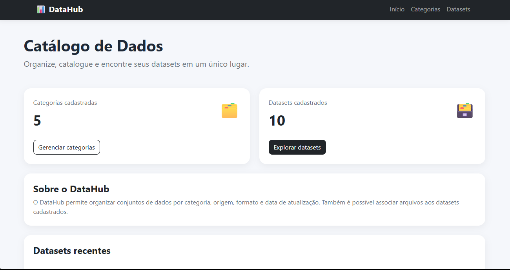
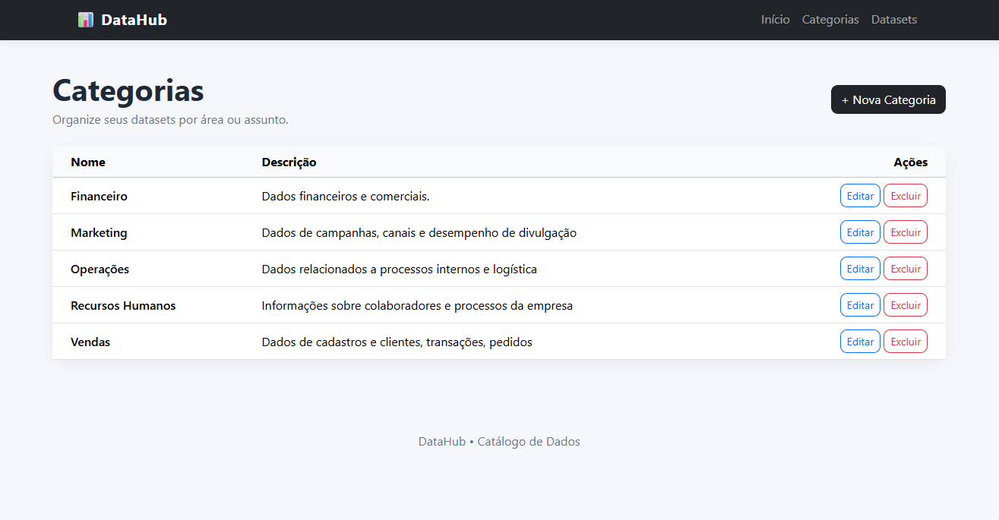
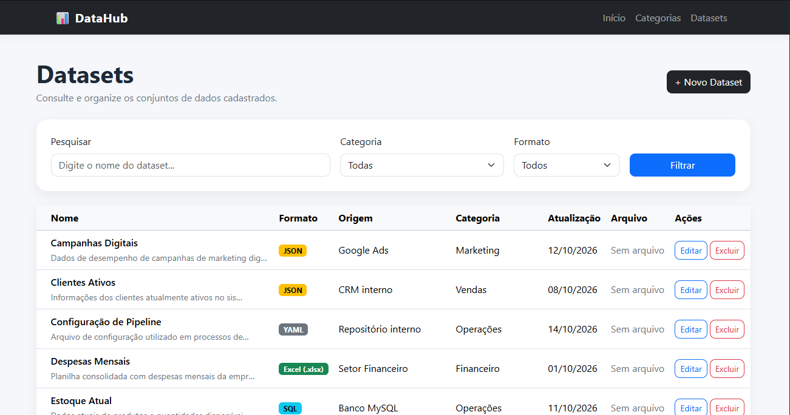
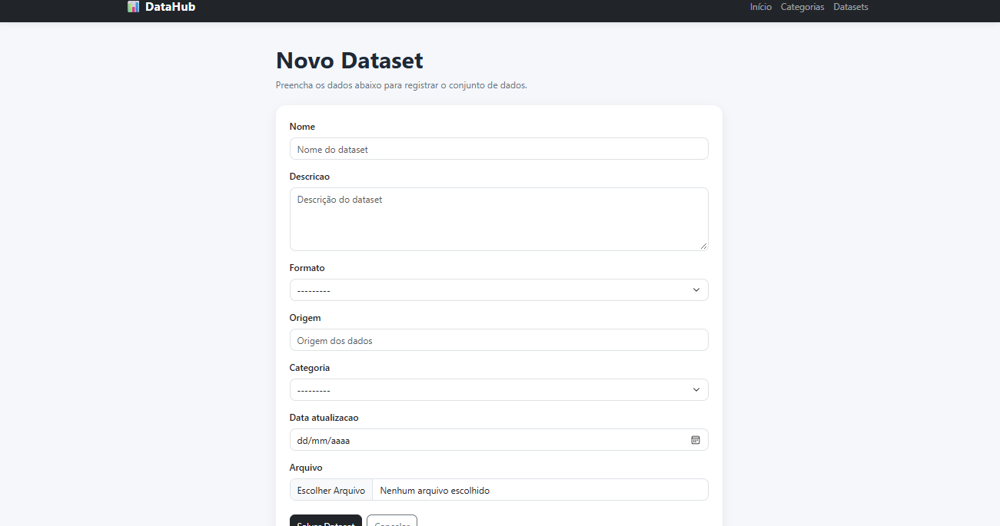

# DataHub 📊

O **DataHub** é uma aplicação web para cadastrar, organizar e encontrar datasets de forma simples.

A versão atual, **vAlpha**, já permite organizar datasets por categoria, pesquisar e filtrar registros, anexar arquivos e validar se a extensão enviada corresponde ao formato selecionado.

---

## Screenshots

### Dashboard



### Categorias



### Datasets



### Cadastro de Dataset




---

## O que é um dataset?

Um **dataset** é, de forma simples, um conjunto de dados relacionados.

Pode ser, por exemplo:

- uma planilha com vendas;
- um CSV com clientes;
- um JSON recebido de uma API;
- dados de funcionários;
- registros de estoque;
- resultados de uma pesquisa.

Um arquivo `vendas_2026.csv`, por exemplo, poderia ter:

| id | produto | quantidade | valor | data |
|---:|---|---:|---:|---|
| 1 | Notebook | 2 | 3500.00 | 10/01/2026 |
| 2 | Teclado | 5 | 150.00 | 10/01/2026 |
| 3 | Monitor | 1 | 1200.00 | 11/01/2026 |

Nesse caso, cada linha representa um registro e cada coluna representa uma informação sobre aquele registro.

O DataHub não guarda apenas o arquivo. Ele também registra informações sobre ele, como nome, origem, formato, categoria e data de atualização.

Essas informações são chamadas de **metadados**.

Por exemplo:

```text
Arquivo: vendas_2026.csv
Nome: Vendas 2026
Formato: CSV
Origem: Sistema ERP
Categoria: Vendas
Atualização: 10/10/2026
```

A ideia do DataHub é facilitar justamente esse tipo de organização: saber **quais dados existem, de onde vieram, em qual formato estão e onde encontrá-los**.

---

## Funcionalidades

Atualmente o DataHub possui:

- CRUD completo de categorias e datasets;
- relacionamento entre Categoria e Dataset com `ForeignKey`;
- upload de arquivos;
- validação da extensão do arquivo;
- pesquisa por nome;
- filtro por categoria e formato;
- dashboard com quantidade de categorias e datasets;
- listagem dos datasets cadastrados recentemente;
- interface responsiva com Bootstrap.

---

## Categorias

As categorias servem para agrupar datasets por assunto ou área.

Alguns exemplos:

```text
Financeiro
Vendas
Marketing
Recursos Humanos
Operações
```

Uma categoria pode possuir vários datasets:

```text
Vendas
├── Vendas 2026
├── Clientes Ativos
└── Pedidos Cancelados
```

---

## Datasets

Cada dataset cadastrado pode possuir:

```text
Nome
Descrição
Formato
Origem
Categoria
Data de atualização
Arquivo
```

Exemplo:

```text
Nome: Indicadores Financeiros
Formato: Parquet
Origem: Data Warehouse
Categoria: Financeiro
Data de atualização: 13/10/2026
```

---

## Formatos aceitos

O DataHub permite catalogar diferentes tipos de arquivo.

| Formato | Extensão | Uso comum |
|---|---|---|
| CSV | `.csv` | Dados em linhas e colunas. É simples e muito comum para troca de dados. |
| JSON | `.json` | Dados estruturados, muito usado em APIs e aplicações web. |
| Excel | `.xlsx` | Planilhas do Excel. |
| Excel legado | `.xls` | Formato mais antigo de planilhas do Excel. |
| SQL | `.sql` | Scripts, comandos SQL ou exportações de bancos de dados. |
| TXT | `.txt` | Arquivos de texto simples. |
| XML | `.xml` | Dados estruturados em tags. |
| Parquet | `.parquet` | Formato colunar eficiente, bastante usado no processamento de grandes volumes de dados. |
| Avro | `.avro` | Formato usado principalmente para troca e processamento de dados em sistemas distribuídos. |
| TSV | `.tsv` | Parecido com CSV, mas usa tabulações para separar os valores. |
| YAML | `.yaml` / `.yml` | Muito usado para arquivos de configuração, inclusive de pipelines e ferramentas de dados. |
| Outro | — | Para arquivos que não estejam entre as opções anteriores. |

### Parquet

O **Parquet** é bastante utilizado em Engenharia de Dados porque armazena os dados de forma colunar.

Em vez de ser apenas um arquivo de texto como CSV, ele é otimizado para leitura e processamento, especialmente quando existem grandes volumes de dados.

### Avro

O **Avro** é um formato voltado para serialização e troca de dados.

É comum em sistemas distribuídos, principalmente quando diferentes aplicações ou serviços precisam enviar dados entre si.

### TSV

O **TSV** é parecido com CSV, mas muda a forma de separar os valores.

```text
CSV:
nome,idade,cidade

TSV:
nome    idade    cidade
```

No TSV, as colunas são separadas por tabulação.

### YAML

O **YAML** costuma ser usado principalmente em arquivos de configuração.

Por exemplo, uma configuração simples de pipeline poderia ser:

```yaml
pipeline:
  nome: vendas
  origem: sistema_erp
  formato: csv
```

---

## Upload e validação de arquivos

Ao cadastrar um dataset, também é possível enviar o arquivo correspondente.

O sistema compara a extensão do arquivo com o formato escolhido.

Exemplo válido:

```text
Formato selecionado: CSV
Arquivo: vendas.csv

✓ aceito
```

Exemplo inválido:

```text
Formato selecionado: CSV
Arquivo: vendas.xlsx

✗ formato incompatível
```

A opção `Outro` não possui essa restrição.

Durante o desenvolvimento, os arquivos enviados ficam armazenados em:

```text
media/datasets/
```

A pasta `media/` não é enviada para o GitHub.

---

## Busca e filtros

A listagem de datasets possui busca pelo nome e filtros por categoria e formato.

É possível, por exemplo, procurar:

```text
Nome: vendas
Categoria: Financeiro
Formato: CSV
```

Os filtros são feitos utilizando o ORM do Django.

---

## Modelagem

O projeto possui dois Models principais:

```text
Categoria
Dataset
```

A relação é de **um para muitos**:

```text
Categoria 1 ───────── N Dataset
```

Uma categoria pode possuir vários datasets, mas cada dataset pertence a uma categoria.

No Django, essa relação é feita com:

```python
categoria = models.ForeignKey(
    Categoria,
    on_delete=models.CASCADE,
    related_name="datasets",
)
```

Usei `CASCADE`, então, se uma categoria for removida, os datasets relacionados a ela também são removidos.

---

## Como o projeto está organizado

O DataHub segue o padrão MTV do Django:

```text
Model
→ estrutura e relacionamento dos dados

View
→ lógica das páginas

Template
→ interface exibida no navegador
```

O fluxo simplificado é:

```text
Usuário
  ↓
URL
  ↓
View
  ↓
Model / MySQL
  ↓
Template
  ↓
Navegador
```

---

## Tecnologias

O projeto utiliza:

```text
Python 3
Django 5.2 LTS
MySQL 8.0
HTML
CSS
Bootstrap 5
Django Templates
Django ORM
Git
GitHub
```

---

## Estrutura

```text
DataHub/
│
├── catalogo/
│   ├── migrations/
│   │
│   ├── templates/
│   │   └── catalogo/
│   │       ├── categorias/
│   │       │   ├── excluir.html
│   │       │   ├── formulario.html
│   │       │   └── lista.html
│   │       │
│   │       ├── datasets/
│   │       │   ├── excluir.html
│   │       │   ├── formulario.html
│   │       │   └── lista.html
│   │       │
│   │       ├── base.html
│   │       └── home.html
│   │
│   ├── forms.py
│   ├── models.py
│   ├── urls.py
│   └── views.py
│
├── datahub/
│   ├── local_settings.py
│   ├── settings.py
│   ├── urls.py
│   ├── asgi.py
│   └── wsgi.py
│
├── .gitignore
├── manage.py
├── requirements.txt
└── README.md
```

> `datahub/local_settings.py` existe apenas localmente e não é enviado para o GitHub.

Alguns arquivos e diretórios locais ignorados pelo Git:

```text
.venv/
media/
datahub/local_settings.py
__pycache__/
```

---

## Rodando o projeto

Clone o repositório:

```bash
git clone URL_DO_REPOSITORIO
cd DataHub
```

Crie um ambiente virtual:

```powershell
py -m venv .venv
```

Ative:

```powershell
.\.venv\Scripts\Activate.ps1
```

Instale as dependências:

```powershell
python -m pip install -r requirements.txt
```

### Banco de dados

Crie o banco no MySQL:

```sql
CREATE DATABASE datahub
CHARACTER SET utf8mb4;
```

### Senha do MySQL

Por segurança, a senha do MySQL não fica salva no repositório.

Crie o arquivo:

```text
datahub/local_settings.py
```

com:

```python
DB_PASSWORD = "sua_senha_do_mysql"
```

Esse arquivo está incluído no `.gitignore`, então não será enviado para o GitHub.

Depois execute:

```powershell
python manage.py migrate
python manage.py runserver
```

A aplicação ficará disponível em:

```text
http://127.0.0.1:8000/
```

---

## Principais rotas

| Página | Rota |
|---|---|
| Início | `/` |
| Categorias | `/categorias/` |
| Nova categoria | `/categorias/nova/` |
| Datasets | `/datasets/` |
| Novo dataset | `/datasets/novo/` |

As rotas de edição e exclusão usam o ID do registro:

```text
/datasets/3/editar/
/datasets/3/excluir/
```

---

## Próximos passos

A versão atual ainda é o começo do projeto.

Algumas melhorias que quero explorar depois são:

- preview de arquivos CSV, Excel e JSON;
- análise de datasets com Pandas;
- quantidade de linhas e colunas;
- detecção de valores nulos;
- detecção de registros duplicados;
- indicadores de qualidade de dados;
- dashboard com gráficos;
- autenticação;
- API REST;
- registro de pipelines;
- armazenamento em nuvem;
- Docker.

Uma possível evolução seria:

```text
DataHub vAlpha ✓
Catálogo + CRUD + Upload
        ↓
DataHub v2 ◌
Preview dos arquivos
        ↓
DataHub v3
Análise com Pandas
        ↓
DataHub v4
Qualidade de dados
        ↓
DataHub v5
Pipelines
        ↓
DataHub v6
API + Cloud
```

---

## O que pratiquei com esse projeto

O projeto me ajudou a praticar principalmente:

```text
Modelagem de dados
Relacionamento 1:N
ForeignKey
CRUD
Django ORM
Forms
Views
Templates
Migrations
MySQL
Upload de arquivos
Validação
Busca e filtros
Organização de um projeto Django
```

---

## Autora

**Maria Clara Ferreira Alves**

Estudante de **Análise e Desenvolvimento de Sistemas**.

---

## Status

**Funcional e em desenvolvimento.**

A versão atual possui CRUD de Categorias e Datasets, MySQL, upload e validação de arquivos, busca, filtros e dashboard.